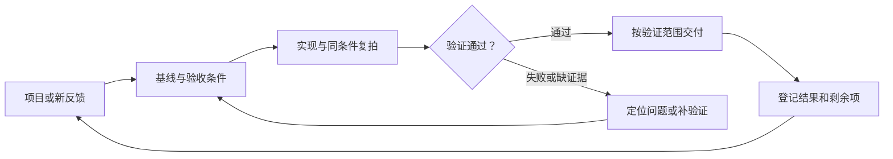

# Little Worlds Studio 研发与迭代工作流

**v1.0 · 2026-11-21**

适用于总仓库 `projects/<product>/` 下的微缩场景，从首个可运行原型到交互预览、手机分享和商品交付。每轮以一个可复现的候选版本交付，反馈、验收和后续决定都能追溯到该版本。



## 1. 建立项目与基线

- 每个商品管理自己的源码、资产、依赖锁文件、参数、说明和验收证据。根目录保存共用流程和技能。同一场景的历史交付从当前交付目录迁出，按版本或日期归档。
- 项目简报记录使用者、打开方式、核心体验、两三个视觉重点、关键取景、目标设备和本轮交付物。区分已明确的需求、从参考图提取的设计原则，以及待验证的假设。后续决定改变范围时，在项目迭代记录中写明被替代的旧要求。
- 首轮记录主镜头、至少一个细节镜头、默认时刻与天气、窄屏首屏和操作路径。开启后续迭代前，保留上个已验收候选的版本标识、复现参数和证据。源码尚无可用提交时，可暂用有日期的候选标识和对应构建产物定位。
- 以工作室的[微缩美术技能](.agents/skills/miniature-world-art-director/SKILL.md)和 [Three.js 工程技能](.agents/skills/threejs-digital-product-engineer/SKILL.md)作为入口。用项目已有的构建工具、浏览器、程序化建模和短录屏完成首轮。遇到重复且可量化的瓶颈时，记录触发场景、现有成本、候选工具和对照试用结果，再决定是否加入插件、MCP 或后期库。

## 2. 把反馈变成验收条件

按「版本与复现 → 症状 → 原因假设 → 要实现的行为 → 验收证据」登记。体验词拆成可以观察的变化。比如「光影平」要指出受影响的立面、灯下区和阴影区，并约定同镜头对照。「像一张图」要记录拖动实际能否改变取景、触屏能否缩放，以及是否进了静态降级。

| 优先级 | 判定与例子 |
| --- | --- |
| P0 | 核心入口或交付无法使用，比如首屏空白、承诺可交互的包无法打开、关键素材授权无法核对。优先恢复可用路径。 |
| P1 | 主要体验偏离验收约定，比如白昼电灯残留、窗光方向错误、手机上旋转失败、深夜题字不可读。先锁定可复现的一个主问题。 |
| P2 | 局部可读性和精修，比如侧栏留白、题签位置、药丸按钮改为文字下划线。随相邻改动复查。 |

使用「待复现 → 待安排 → 实施中 → 待验收 → 已验收」追踪。需求被撤回或修改时，记录「已替代」和新决定。实现已合入候选、证据仍缺的条目停在待验收，注明缺少的设备、状态或观察结果。

## 3. 选择进入阶段

新项目按阶段推进。已有项目从命中反馈的阶段进入，按受影响面复查。例如修复白昼残光，需要回到灯光状态，再覆盖天气、回切和当前交付包。

| 阶段 | 工作内容 | 离开阶段的证据 |
| --- | --- | --- |
| 定方向与灰模 | 划商品范围和主要操作路径，做主构图、比例、轮廓、底座与渲染容器。交付方式尽早在目标环境试一次。 | 同一灰模在桌面和目标窄屏都保留主体与入口。交互项目在这一阶段演示真实拖动和缩放。 |
| 做最小完整切片 | 选一个取景，贯通主要光源、材质、环境反馈和一项真实交互。 | 能从用户入口重现主体验，例如暖光从室内开口穿出，夜间切回白昼会熄灭。 |
| 扩到当前范围 | 再精修几何、材质、远景、天气、动画、取景与 UI。时刻、天气、风力、相机、音频各有清楚的状态职责。 | 状态组合可切换并可回到基线。桌面可操作，触控入口可发现。 |
| 复拍和回归 | 固定随机种子、相机、天气、时刻、视口与动画时点复拍。对运动、惯性或音频用短录屏、事件或时间采样。 | 改前和改后同条件证据，主要路径实测，关键失败与回退条件有结果。 |
| 打包和交付 | 用生产构建验证实际要发送的文件，从空目录或目标部署入口打开。核对资源、许可、文档与生成命令。 | 交付物可独立打开，已验证的设备与限制写进说明，当前版本有唯一入口。 |

## 4. 按改动范围选验证

每轮至少复现先前问题、验证改后行为、跑一次主要用户路径。视觉精修记录对照图。涉及状态、资源、移动端或交付方式时，启用下面对应的检查。

| 改动 | 核查方法与证据 |
| --- | --- |
| 建筑、材质与灯光 | 同一全景加一个受影响近景。区分灯罩发光、光是否照到墙面或石板、遮光与反射。看日间、傍晚、深夜和关键回切。修改室内光时，从外面确定光穿过哪个开口。 |
| 天气与环境动画 | 覆盖所支持的核心时刻 × 天气组合。观察天空、远景、光影、地面和粒子是否一致。对比风力两端、动效暂停和恢复。把湿地反射等额外渲染开销记入性能检查。 |
| 观察与控件 | 从实际入口拖动、滚轮或双指缩放、切预设再回全景。验证惯性收敛、触控不误滚、键盘焦点、选中反馈、减少动态效果。查紧凑屏幕上的入口可见性、文字在真实背景上的可读性和遮挡。 |
| 音频与授权 | 按当前产品的播放策略验证首载、启停、续播或循环、独立开关和加载失败后的恢复。记录每项第三方资产的名称、作者、原始来源、许可、修改与实际交付中的署名入口。 |
| 工程与移动交付 | 运行该项目的生产构建。用干净目录加载实际交付，按承诺验证断网、资源请求和静态降级。记录视口、浏览器，以及实际是否为手机真机。涉及渲染生命周期时验证缩放、释放和重复挂载。 |

先确定本轮范围和目标规格，再用工作室视觉评分表复评。项目已有明确目标时用项目目标，其他项目采用评分表的建议线。分数写上候选版本、权重、取景、对照证据和仍扣分的原因。分别记录自动化检查与视觉复评结果。移动模拟证据可用于布局和触控路径，真机流畅度及文件打开方式以实际设备记录为准。[工作室视觉评分表](.agents/skills/miniature-world-art-director/references/visual-review.md)

本地评审、手机分享和公开发布分别写明验证范围。公开发布候选需要满足已约定的项目门槛、主要路径通过和必要的资产许可。视觉分项有证据缺口时标记待验证。对依赖中断、核心打开失败等问题单独保留阻断状态。

## 5. 交付后开始下一轮

1. 在产品的迭代记录中填入反馈编号、决策、实际改动、验收结果与剩余项。详细复现步骤和证据放在产品 `docs/QA.md`。使用方式或产物变化同步到产品 README。
2. 给出当前实际可用的入口，写明完成和待验证的范围。后续反馈先对照这份候选与期望，再按优先级选择下一轮最重要的结果。
3. 某个问题跨轮复现，或一次就影响核心交付时，补一条可执行检查。该条检查适合其他项目时再更新总仓库流程，记录触发条目、证据和何时复看效果。项目的具体色板、状态表和评审标准保留在各自记录。

### 每轮记录模板

```md
## <日期> · <候选标识>

- 基线与复现环境：
- 本轮目标及交付入口：

| 编号 | 反馈与复现 | 原因或待验证假设 | 优先级 | 决策与验收动作 | 证据与状态 |
| --- | --- | --- | --- | --- | --- |
| <编号> | <用户动作、状态或附件参考> | <可核对的原因> | <P0–P2> | <可观察的通过条件> | <链接、环境与结论> |

- 回归范围与结果：
- 已替代的要求及对应决定：
- 待验证、负责人或所需条件：
- 下一轮首要事项：
```

## 工作流修订记录

| 版本 | 日期 | 触发与改动 | 复看时点 |
| --- | --- | --- | --- |
| v1.0 | 2026-11-21 | 由书店的静态到交互、夜间光影回切与手机文件分享复盘提取。引入版本化验收、证据范围和交付验证。 | 书店完成真机验收，或下一商品完成第一个完整切片时。 |

实际用法见[蓝花楹书店迭代与复盘](projects/jacaranda-bookshop/docs/ITERATIONS.md)。
