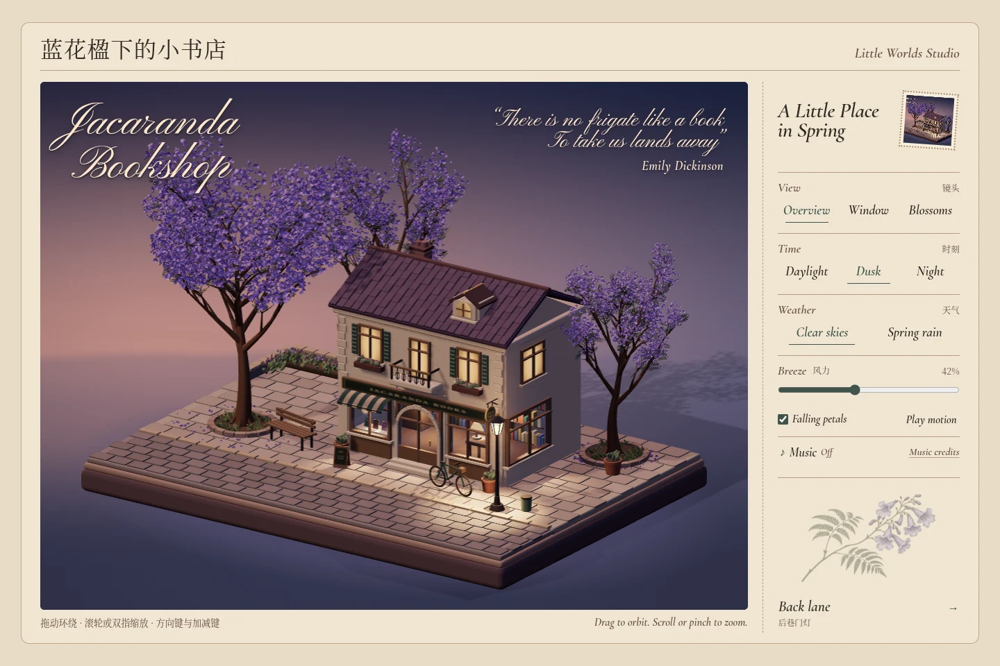

# Jacaranda Bookshop · 蓝花楹下的小书店

*A Little Place in Spring* 是 Little Worlds Studio 的独立微缩场景工程。交互 Demo 支持带惯性的环绕镜头和独立的时刻、天气和风力控制。



## 手机分享

运行 `npm run build:mobile` 后，将 `release/Jacaranda-Bookshop-Mobile.html` 作为文件发送。画面、字体、配乐和授权随 HTML 一起保存。支持本地 HTML 和 WebGL 2 的浏览器可离线互动。只提供静态预览的应用会显示场景封面。[手机打开方式](docs/INSTALLATION.md#手机单文件)

## 本地运行

在本目录使用 Node.js 22.12 或更高版本。

```sh
npm ci
npm run dev
```

用 `npm run build` 生成 `dist/`，再用 `npm run preview` 通过 HTTP 检查产物。每个命令均从本项目目录执行。

在画布上拖动旋转，用滚轮或双指缩放。画布获得键盘焦点后可用方向键旋转、加减键缩放。**Overview** 恢复初始镜头，**Window** 和 **Blossoms** 用于近距离查看。明信片下方的 **Back lane** 转到后门壁灯。**Daylight**（白昼）、**Dusk**（傍晚）、**Night**（深夜）可与晴空或春雨独立组合，题字和引句随画面换色。**Breeze** 调节树冠、雨线和飘花受风的程度。**Pause motion** 暂停场景与题字浮动，相机仍然可用。

**Music** 开启或暂停两首本地钢琴配乐的循环播放。页面默认静音，环境动效和音乐可各自暂停。[曲目和授权](public/licenses/Soundtrack.html)

每轮修改和待验证项见[迭代与复盘](docs/ITERATIONS.md)。当前截图和交互验证见[运行验收](docs/QA.md)。

## 开发资料

- [安装与嵌入](docs/INSTALLATION.md)
- [工程结构](docs/ARCHITECTURE.md)
- [参数定制](docs/CUSTOMIZATION.md)
- [授权草案](docs/LICENSE.md)
