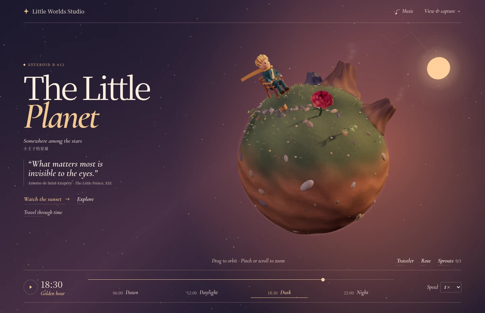

# The Little Planet · 小王子的星球

**Somewhere Among the Stars｜在星星之间**

给桌面与手机浏览器的互动微缩星球。土壤、玫瑰、火山与角色由 Three.js 程序化建模。默认时间定在 18:30，手作岩层承托剪影，小王子和木椅在一侧，红玫瑰在另一侧。场景光、太阳、月亮与故事动作随时刻变化。



## 运行

使用 Node.js 22.12+，在本项目目录执行。

```sh
npm ci
npm run dev
```

`npm test` 验证快速拖动、跨午夜光线连续性以及日常动作的时段、完成和打断。`npm run build` 生成 `dist/`，用 `npm run preview` 查看生产版本。

## 体验与素材

- 拖动、滚轮或双指操作真实三维模型。画布支持方向键与加减键。
- 底部时间轴覆盖 00:00–23:59，按播放键循环并可调速。松开时间轴或选定时刻后，**Dawn** 会浇水，**Daylight** 会巡视星球，**Night** 会抬起并放好玻璃罩。快进时，时钟会给当前动作留出完成时间。手动故事有优先权，查看物体介绍时日常动作仍可继续。
- 底栏可以直接查看旅人、玫瑰、绵羊箱、三座火山及三株幼苗，也可直接点击模型。选中后左侧显示介绍，右侧 **In my own words** 展开该物体的第一人称独白。手机上独白入口靠右，排在介绍下方。[独白与快捷栏预览](docs/monologue-v03.webp)
- 选 **Rose** 可浇水或夜间开合玻璃罩。三株幼苗分别可清理，清理后仍可重读介绍和独白。点击 **Watch the sunset** 播放约 20 秒的可退出过场。
- **View & capture** 内可切换画质、减少动态效果、隐藏界面，以及导出横版 1600×1080 PNG 或竖版 1200×1600 PNG。自动展示可反复播放，用于录屏。隐藏界面后按 Esc 或双击模型恢复。
- **Music** 默认关闭，点击后循环播放 HoliznaCC0 的《Canon Event》，一首偏伤感的 Lo-fi 流行纯音乐。界面中两处引句自译自《小王子》第二十一章法文原文。[配乐、引文与许可](public/licenses/soundtrack.html)

## 工程结构

| 位置 | 职责 |
| --- | --- |
| `src/models/` | 球面地形、角色关节、木椅、玫瑰、玻璃罩、三座火山及幼苗 |
| `src/core/TimeEngine.js` | 24 小时状态、连续过渡、氛围参数 |
| `src/core/CameraDirector.js` | 带惯性的环绕、取景与过场 |
| `src/core/StorySequence.js` | 故事选择、动作时间线、完成与退出 |
| `src/core/DailyRoutine.js` | 定时浇水、球面巡视、盖罩与手动故事优先级 |
| `src/core/createAtmosphere.js` | 天光、投影、独立天体背景与火山蒸汽 |
| `src/main.js` | 网页交互、渲染生命周期、质量选项、音频与 PNG 导出 |

启动时未在已检查工作区找到策划所指的星球 V1。当前将独立目录作为新的候选基线，复用工作室的资源释放、种子随机数与现有工具配置。[迭代记录](docs/ITERATIONS.md) · [运行验收](docs/QA.md) · [工作室迭代工作流](../../WORKFLOW.md)
